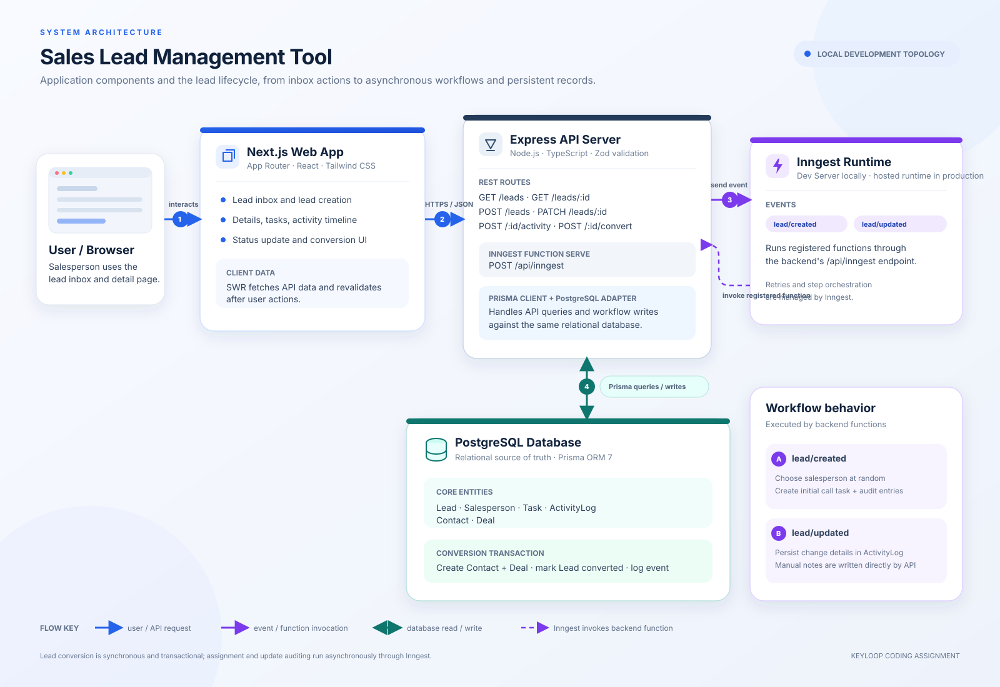

# Sales Lead Management Tool

A sales lead management application built for the Keyloop coding assignment. The current implementation is a **minimum viable product (MVP)**: a focused version with the core features needed to demonstrate the assignment. It includes a Next.js frontend, an Express API, PostgreSQL storage through Prisma, and Inngest workflows for lead assignment, follow-up tasks, and activity logging.

## Features

- Architecture diagram: [architecture.svg](architecture.svg).
- Lead inbox with salesperson filtering, open-lead count, and lead creation.
- Lead details with assignment, follow-up tasks, status, and an activity timeline.
- Manual activity notes and lead status updates.
- Automatic salesperson assignment and initial follow-up task through Inngest.
- Transactional conversion of an assigned lead into a contact and deal.
- Input validation with Zod and a typed Prisma schema with enums.

## Technology

- **Frontend:** Next.js App Router, React, Tailwind CSS, SWR.
- **Backend:** Node.js 20, Express, TypeScript, Zod.
- **Data:** PostgreSQL, Prisma ORM 7 with the PostgreSQL driver adapter.
- **Workflows:** Inngest.
- **Tests:** Vitest, Supertest, and React Testing Library.

## Data model

PostgreSQL stores the core entities and their relationships:

- **Lead:** contact details, status, assigned salesperson, and optional conversion links.
- **Salesperson:** the team member responsible for leads and deals.
- **Task:** follow-up work associated with a lead and salesperson.
- **ActivityLog:** timestamped history of lead and workflow actions.
- **Contact and Deal:** customer and financial records created when a lead converts.

Prisma defines the relations and lifecycle enums used by the API and workflows. See `backend/prisma/schema.prisma` for the implemented schema.

## Architecture and data flow



The Next.js frontend calls the Express REST API. The API validates requests, reads and writes PostgreSQL through Prisma, and sends lead events to Inngest. Inngest handles asynchronous assignment and follow-up work, then persists workflow results through the backend's database layer. Lead conversion runs as a database transaction so the contact, deal, lead status, and conversion activity stay consistent.

1. The user creates a lead from the inbox, and the frontend sends it to `POST /leads`.
2. The API stores the lead and emits `lead/created`.
3. Inngest assigns a salesperson, creates an initial follow-up task, and records creation and assignment activity.
4. The user can view the lead, update its status, or log an activity. Lead updates are recorded in the activity history.
5. On conversion, the API creates a contact and deal, updates the lead, and records conversion activity in one transaction.

## Implementation Plan (Backend Focus)

### Objective

Implement a robust backend for the Sales Lead Management Tool with automated workflows for assignment, task creation, and activity logging. Provide a functional Next.js interface to demonstrate the lead details and activity log features.

### Phase 1: Foundation and Schema — Complete

- [x] Initialize the Node.js backend and install Express, Prisma, Inngest, and Zod.
- [x] Define the Prisma schema based on the system design.
- [x] Run migrations and seed the database with initial salespeople.

### Phase 2: Workflow Engine (Inngest) — Complete

- [x] Set up the Inngest client and Express endpoint.
- [x] Implement the `lead/created` workflow for assignment, initial task creation, and activity entries.
- [x] Implement the `lead/updated` workflow to capture lead changes in `ActivityLog`.

### Phase 3: API Implementation — Complete

- [x] **Lead inbox:** `GET /leads`, filterable by assigned salesperson.
- [x] **Lead details:** `GET /leads/:id`, including related tasks, activity logs, contact, and deal.
- [x] **Log activity:** `POST /leads/:id/activity` for manual activity entries.
- [x] **Convert lead:** `POST /leads/:id/convert`, using a transaction to create a contact and deal, mark the lead converted, and record activity.

### Phase 4: Frontend — Core MVP Complete

- [x] Create the Next.js App Router application.
- [x] **Inbox page:** lead list, open-lead count, and create-lead form.
- [x] **Details page:** lead header, tasks, chronological activity timeline, status control, and conversion form.
- [x] **Activity form:** form to log calls and notes.
- [x] Use SWR to fetch and refresh API-owned data; keep transient UI state in React state.

### Verification and Testing

- [x] **Unit tests:** salesperson selection has deterministic tests for first/last selection and the empty-salesperson error.
- [x] **Backend tests:** route tests cover listing, creation/event delivery, and conversion success/error cases. The user reported `npm test` passed with 10 tests across two files, and `npm run typecheck` passed.
- [x] **Frontend tests:** inbox and detail action tests cover fetching, lead creation, note logging, and status updates. The user reported the frontend test suite passed.
- [x] **Manual verification:** end-to-end flow from lead creation and assignment through activity logging, status update, and conversion.

## Build for the Future

The MVP uses a relational schema for leads, salespeople, tasks, contacts, deals, and activity history. Prisma relations and enum fields make data relationships and lifecycle states explicit. Lead conversion uses a database transaction so contact creation, deal creation, status change, and conversion logging succeed or roll back together. Inngest moves assignment and follow-up work out of the request path. The lead-created workflow uses deterministic IDs for its initial task and creation/assignment log entries, making those writes safe to repeat. Zod validates incoming request bodies, and the route and component tests provide a base for future changes.

The current implementation is sized for a local assignment demo. To support production scale and stronger operational guarantees, the next steps would be:

- **Scalability and performance:** Add pagination to lead listing and indexes for common filters and sort orders, such as salesperson, status, and creation time. Replace random assignment with a policy such as least-active workload when assignment volume or fairness requirements grow.
- **Reliability:** Use a transactional outbox or equivalent event-delivery pattern for database writes that must reliably publish Inngest events. Add retry and dead-letter procedures, and test workflow replay and partial failure against a real test database.
- **Security:** Add authentication, role-based authorization, rate limiting, and production secret management before exposing the API beyond a trusted local environment.
- **Maintainability:** Split route handlers and validation schemas into focused modules as the API grows. Keep API types shared or generated so frontend and backend contracts do not drift.
- **Observability:** The `ActivityLog` provides a business audit trail, and the Inngest Dev Server exposes local workflow runs. Add structured application logs, request IDs, metrics, tracing, alerting, and separate liveness/readiness checks for production operations.

## Run locally

See [backend/README.md](backend/README.md) and [frontend/README.md](frontend/README.md) for complete setup, configuration, API details, and manual test cases.

1. Configure `backend/.env` with a PostgreSQL `DATABASE_URL` and `PORT=3001`.
2. From `backend`, install dependencies, generate Prisma Client, apply migrations, and seed the sample salespeople:

   ```powershell
   npm install
   npm run db:generate
   npm run db:migrate -- --name init
   npm run db:seed
   ```

3. Start the Inngest Dev Server in its own terminal:

   ```powershell
   cd F:\Projects\keyloop-assignment\backend
   npx inngest-cli@latest dev -u http://localhost:3001/api/inngest
   ```

4. Start the API in another terminal:

   ```powershell
   cd F:\Projects\keyloop-assignment\backend
   npm run dev
   ```

5. Set `frontend/.env.local` to `NEXT_PUBLIC_API_URL=http://localhost:3001`, then start the frontend:

   ```powershell
   cd F:\Projects\keyloop-assignment\frontend
   npm install
   npm run dev
   ```

6. Open [http://localhost:3000](http://localhost:3000).

## Automated checks

Run each command from its project directory.

```powershell
# backend
npm test
npm run typecheck

# frontend
npm test
npm run lint
npm run build
```

The backend test suite has 10 passing tests across route behavior and random salesperson selection. The frontend test suite covers inbox fetching/creation and lead detail note/status actions. API/database calls are mocked in the automated tests; the live flow was also manually verified with PostgreSQL and the Inngest Dev Server.

## AI Collaboration Narrative

I used Gemini CLI to create the initial implementation plan. I then worked through that plan in small phases: database schema and seed data, Inngest workflows, REST endpoints, and the Next.js user interface. I asked AI for focused implementation guidance and pasteable snippets for each step, then applied the changes in the project and brought back terminal output or screenshots when something failed.

I treated generated code as a proposal to verify. I checked the API contract against the Prisma models, ran the backend typecheck and automated tests, and exercised the application manually from lead creation through assignment, task creation, activity logging, status changes, and conversion. When frontend linting flagged state updates initiated from effects, I reviewed the issue and changed the client data-fetching approach to SWR. When a frontend test failed after that change, I isolated SWR's shared test cache and gave each test a fresh cache before rerunning the suite. The backend suite finished with 10 passing tests, and the frontend test suite passed.

I also kept the documentation aligned with the implementation and recorded remaining checks instead of treating unverified output as a pass. Before submission, run the frontend lint and production build and compare the application against every requirement in the original assignment brief.